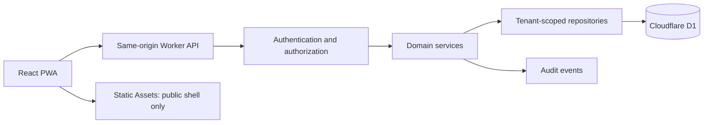

# Architecture and decision log

Status: design baseline, not implemented. Date: 2026-10-15.

## Proposed deployment



Use one deployable application initially. The browser never accesses D1 directly. APIs live under /api/v1 and return JSON errors rather than SPA HTML. Route /api/* through the Worker before static fallback. Public application assets must never contain patient data or secrets.

## Proposed repository layout

```text
src/                 React shell, routes, components, feature modules
worker/              API handlers, auth adapter, policies, services, repositories
shared/              Zod contracts, enums, measurement schemas
database/            Drizzle definitions and reviewed migration SQL
catalogue/           versioned synthetic/reviewed definition seeds
tests/               unit, Worker integration, tenant isolation, browser tests
docs/                durable product/engineering guidance
scripts/             development and verification helpers
public/              approved static assets only
```

This is a proposed modular monolith, not an existing tree. Avoid a multi-package monorepo until independent build or ownership requirements justify it. Keep provider-specific storage behind repositories without pretending D1 and PostgreSQL share every capability.

## Decisions

| ID | Decision | Status | Reason / revisit trigger |
|---|---|---|---|
| ADR-001 | Universal multi-tenant product | Source requirement | Centres configure the same codebase |
| ADR-002 | React/TS/Vite + Workers Static Assets + D1 | Selected baseline | Explicit brief; verify quotas before rollout |
| ADR-003 | Drizzle, Zod, React Hook Form, TanStack Query, Tailwind/shadcn | Selected baseline | Brief specifies these; pin compatible versions at scaffold |
| ADR-004 | One app, same-origin API, modular monolith | Proposed | Simpler operations and cookie/CORS boundary |
| ADR-005 | Online clinical writes; public-shell offline only | Selected baseline | Identifiable offline storage needs separate threat model |
| ADR-006 | Deterministic reviewed suggestions | Source requirement | Explainable, no paid model dependency |
| ADR-007 | Shared D1 with explicit tenant enforcement | Proposed | Prototype simplicity; test every relationship and access path |
| ADR-008 | Auth library choice pending feasibility spike | Open/blocking auth implementation | Password work factor, Workers CPU, session/recovery and free budget must all be satisfied |
| ADR-009 | No file uploads in first slice | Proposed deferral | Storage, malware handling and access lifecycle unproven |
| ADR-010 | No runtime AI or external messaging in MVP | Selected baseline | Cost, consent and data-flow constraints |

## Hard technical spikes before feature expansion

1. **Authentication:** evaluate maintained Workers-compatible libraries against D1 sessions, secure hashing, CSRF, invitation/recovery and revocation. Benchmark under actual Free-plan limits using synthetic credentials. If secure hashing exceeds capacity, record the conflict and revisit hosting/auth; never reduce security silently.
2. **Atomic workflows:** demonstrate appointment conflict checks, resource reservation, note signing plus audit, and replay-safe mutations using supported D1 primitives. A read followed by an unguarded write is not concurrency protection. Test simultaneous requests. Consult current D1 transaction/batch semantics before design commitment.
3. **Frontend routing:** deep-link refresh, API 404 JSON, security headers, CSP and worker-first API behavior.
4. **Recovery:** migrate and seed a local database, export it, restore to a fresh target and verify relationships and signed-history integrity.

## Configuration contract

Version centre identity, timezone, enabled disciplines, hours, scheduling defaults, branch settings and clinical workflow prerequisites. Validate configuration on the server. Settings control visibility and eligibility but never bypass authorization. Disabling a service stops new use while preserving history and surfacing affected future appointments. Use explicit migrations for configuration schema changes.

## Client state

Query keys include organization and resource scope. Clear sensitive query caches on logout, revocation and organization switch; never persist them automatically. Form state remains distinct from server-confirmed data. Show saving/saved/failed/conflicted states. Use version checks; invalidate related queries after confirmed writes. Abort or ignore responses arriving from a previous organization context.
